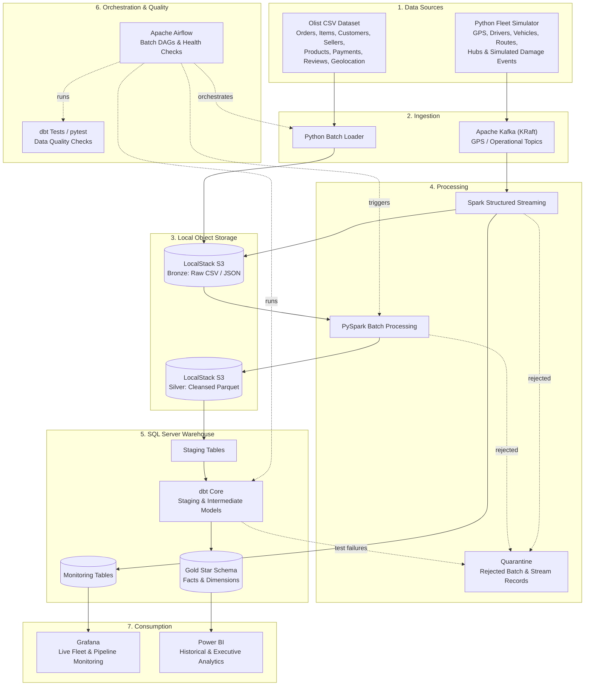

# 🚚 Smart E-Commerce Logistics Data Platform
[](https://github.com)
[](https://www.docker.com/)
[](https://kafka.apache.org/)
[](https://spark.apache.org/)
[](https://www.getdbt.com/)
[](https://airflow.apache.org/)
[](https://www.localstack.cloud/)
[](https://www.microsoft.com/sql-server)
[](https://powerbi.microsoft.com/)
[](https://grafana.com/)
[](https://www.python.org/)

An end-to-end data engineering platform for **e-commerce delivery analytics and simulated real-time fleet monitoring**. The platform combines the historical **Brazilian E-Commerce Public Dataset by Olist** with a generated GPS telemetry stream to demonstrate batch ingestion, distributed processing, streaming analytics, data quality controls, dimensional modeling, orchestration, and operational dashboards.

The solution follows a **Medallion Architecture (Bronze, Silver, Gold)** and uses **LocalStack S3** as its local S3-compatible object storage, **Apache Kafka** for event streaming, **Apache Spark** for batch and streaming processing, **dbt Core** for warehouse transformations, **SQL Server** as the analytical warehouse, **Airflow** for orchestration, **Grafana** for live operational monitoring, and **Power BI** for historical and executive analytics.

> **Data transparency:** Olist supplies historical e-commerce transactions. It does not provide live vehicle GPS, driver, vehicle, route execution, hub operations, or verified package-damage events. Those operational datasets are generated by this project for simulation and are explicitly treated as synthetic data. Any analysis combining them must be interpreted as a simulated operational scenario, not as a measured fact about Olist's real deliveries.

---

## 📑 Table of Contents

- [Business Problem & Objectives](#-business-problem--objectives)
- [Data Sources](#-data-sources)
- [Key Business Questions](#-key-business-questions)
- [Technology Stack](#-technology-stack)
- [System Architecture](#-system-architecture)
- [Data Flow & Medallion Architecture](#-data-flow--medallion-architecture)
- [Batch Pipeline: Olist Dataset](#-batch-pipeline-olist-dataset)
- [Streaming Pipeline: Fleet GPS Simulation](#-streaming-pipeline-fleet-gps-simulation)
- [Data Quality & Quarantine](#-data-quality--quarantine)
- [Data Warehouse & Dimensional Model](#-data-warehouse--dimensional-model)
- [dbt Transformation & Lineage](#-dbt-transformation--lineage)
- [Orchestration](#-orchestration)
- [Analytics & Dashboards](#-analytics--dashboards)
- [Monitoring & Alerting](#-monitoring--alerting)
- [Project Structure](#-project-structure)
- [Local Development Setup](#-local-development-setup)
- [Implementation Roadmap](#-implementation-roadmap)
- [Testing Strategy](#-testing-strategy)
- [Design Decisions & Trade-offs](#-design-decisions--trade-offs)
- [Limitations & Assumptions](#-limitations--assumptions)

---

## 🎯 Business Problem & Objectives

Logistics operations need reliable visibility into order fulfillment, delivery performance, fleet activity, and data pipeline health. Without integrated batch and streaming data, it is difficult to identify delayed deliveries, understand regional bottlenecks, monitor fleet utilization, and detect data-quality issues early.

This project demonstrates a data platform that addresses these challenges through:

1. **Historical batch analytics:** Ingesting and transforming Olist orders, customers, sellers, products, payments, reviews, and geolocation data.
2. **Simulated real-time fleet visibility:** Generating GPS events for simulated drivers and vehicles, then processing them continuously through Kafka and Spark Structured Streaming.
3. **Scalable data storage and processing:** Storing raw and curated files in LocalStack S3 and using Spark for distributed transformations.
4. **Reliable warehouse modeling:** Building a SQL Server analytical warehouse with dbt-managed staging, intermediate, and dimensional mart models.
5. **Automated data quality:** Validating batch and streaming records, retaining rejected data in quarantine, and recording rejection reasons.
6. **Orchestration and observability:** Scheduling batch workflows with Airflow and monitoring application, streaming, and pipeline health.
7. **Business-facing analytics:** Using Grafana for operational monitoring and Power BI for historical and executive reporting.

---

## 📦 Data Sources

### 1. Historical batch source — Olist

**Brazilian E-Commerce Public Dataset by Olist**

The Olist dataset contains historical Brazilian e-commerce order and fulfillment records. It is the primary real-world batch source for this project.

Main CSV files:

| Dataset | Purpose |
|---|---|
| `olist_orders_dataset` | Order lifecycle and purchase / delivery timestamps |
| `olist_order_items_dataset` | Products, sellers, item prices, and freight values per order |
| `olist_customers_dataset` | Customer identifiers, ZIP prefixes, city, and state |
| `olist_sellers_dataset` | Seller identifiers and location attributes |
| `olist_products_dataset` | Product categories, dimensions, and weight |
| `olist_order_payments_dataset` | Payment methods, installments, and payment values |
| `olist_order_reviews_dataset` | Customer review scores and review timestamps |
| `olist_geolocation_dataset` | Latitude and longitude associated with ZIP-code prefixes |
| `product_category_name_translation` | Portuguese-to-English product category mapping |

**Important modeling notes:**

- `order_id` identifies an order; `order_item_id` identifies an item within an order.
- One order may contain multiple items and may involve multiple sellers. Keep order-level and item-level facts at their correct grains to avoid duplicated order measures.
- Customer and seller ZIP prefixes can be associated with geolocation data. Since a ZIP prefix can have multiple coordinate rows, clean and aggregate geolocation records before using them for mapping.
- Olist provides purchase, carrier handoff, estimated delivery, and customer delivery timestamps. It does not provide actual GPS route traces or driver assignments.
- The dataset is historical and does not contain a general-purpose `updated_at` column for CDC. Batch incrementality should therefore be based on ingestion batches, source snapshots/checksums, stable business keys, and controlled reprocessing—not on an invented source update timestamp.

### 2. Simulated streaming source — Fleet telemetry

A Python-based simulator generates operational events that are not available in Olist, such as:

- Driver and vehicle identifiers
- GPS latitude and longitude
- Event timestamps
- Vehicle speed and movement status
- Simulated route and hub identifiers
- Optional battery / telemetry attributes
- Simulated delivery status and operational events

The simulator publishes JSON events to Kafka. The event schema is versioned to demonstrate schema evolution and backward-compatible processing.

### 3. Simulated operational reference and event data

The project may also generate reference and event records for:

- Drivers and vehicles
- Hubs and delivery routes
- Dispatch / delivery activity
- Package damage events

These records are synthetic. Package damage is not an actual field or verified event in the Olist dataset. Any damage-rate analysis or relationship between speed and damage is a simulation-based demonstration.

---

## ❓ Key Business Questions

1. **Delivery performance:** What percentage of eligible delivered orders arrived after the estimated delivery date, and which customer or seller regions show the highest late-delivery frequency?
2. **Operational risk (simulated):** In the generated fleet scenario, how are vehicle speed and transit duration associated with simulated late deliveries or package-damage events?
3. **Fleet allocation (simulated):** What are the busiest simulated delivery hours and geographic zones, and how can fleet capacity be allocated accordingly?
4. **Pipeline reliability:** How many records are ingested, processed, rejected, or delayed across the batch and streaming pipelines?

### KPI definitions

| KPI | Definition / Notes |
|---|---|
| On-time delivery rate | Eligible delivered orders delivered on or before the estimated delivery timestamp ÷ eligible delivered orders |
| SLA breach rate | Eligible delivered orders delivered after the estimated delivery timestamp ÷ eligible delivered orders |
| Delivery duration | `order_delivered_customer_date` minus `order_purchase_timestamp` |
| Carrier handling duration | `order_delivered_carrier_date` minus `order_purchase_timestamp` |
| Last-mile duration | `order_delivered_customer_date` minus `order_delivered_carrier_date` |
| Average delivery delay | Actual customer delivery timestamp minus estimated delivery timestamp, for delivered orders |
| Simulated damage rate | Simulated damage events ÷ simulated deliveries, using a documented denominator |
| Fleet active count | Number of simulated vehicles / drivers considered active under the project's status rule |
| GPS event throughput | Number of telemetry events processed per time interval |
| Quarantine rate | Rejected records ÷ total records evaluated |

**SLA interpretation:** Olist's estimated delivery date is used as a proxy SLA target for analytical purposes. It should not be described as a verified contractual SLA. Canceled, unavailable, or incomplete orders and records with missing delivery timestamps must be handled explicitly in the KPI denominator.

**Time interpretation:** `order_purchase_timestamp` represents order creation, not driver dispatch or vehicle departure. Peak *order creation* hours can be derived from Olist. Peak *fleet activity / delivery operation* hours must be derived from the simulated dispatch or GPS events.

---

## 🧰 Technology Stack

| Area | Technology | Responsibility |
|---|---|---|
| Batch source | Olist CSV dataset | Historical e-commerce and fulfillment data |
| Synthetic event generation | Python | GPS, fleet, route, hub, and operational event simulation |
| Streaming ingestion | Apache Kafka (KRaft) | Durable event topics and stream ingestion |
| Object storage | **LocalStack S3** | Local S3-compatible storage for raw and curated data files |
| Batch processing | PySpark | Distributed cleaning, standardization, and file transformations |
| Stream processing | Spark Structured Streaming | Parsing, validation, deduplication, windows, and stream sinks |
| Warehouse transformations | dbt Core (`dbt-sqlserver`) | SQL-based staging, intermediate, and dimensional models |
| Data warehouse | Microsoft SQL Server | Staging, monitoring, and analytical Gold models |
| Orchestration | Apache Airflow | Batch pipeline scheduling, dependencies, retries, and quality checks |
| Data quality | PySpark validations + dbt tests + pytest | Schema, null, uniqueness, relationships, and business-rule checks |
| Operational dashboards | Grafana | Live fleet and pipeline monitoring |
| Business analytics | Power BI | Historical delivery and executive analytics |
| Deployment | Docker Compose | Reproducible local infrastructure |
| Version control / CI | Git + GitHub Actions | Source control, automated checks, and collaboration |

---

## 🏗 System Architecture



**Architecture principle:** Airflow orchestrates finite batch workflows and scheduled checks. Kafka and Spark Structured Streaming operate as long-running services; Airflow monitors their health rather than scheduling each streaming micro-batch.

---

## 🥉🥈🥇 Data Flow & Medallion Architecture

| Layer | Storage / Technology | Responsibility |
|---|---|---|
| **Bronze — Raw** | LocalStack S3 | Immutable source files and original event payloads, organized by source and ingestion batch / date |
| **Silver — Cleansed** | LocalStack S3, Parquet | Standardized, typed, deduplicated, and validated batch data; validated stream outputs where appropriate |
| **Gold — Curated** | SQL Server + dbt | Business-ready facts, dimensions, and aggregate models for reporting |
| **Quarantine** | LocalStack S3 and/or SQL Server quarantine tables | Invalid records with original payload, source, processing time, and rejection reason |

Example S3 key layout:

```text
s3://smart-logistics/
├── bronze/
│   ├── olist/
│   │   ├── orders/ingestion_date=YYYY-MM-DD/batch_id=.../
│   │   ├── order_items/ingestion_date=YYYY-MM-DD/batch_id=.../
│   │   ├── customers/ingestion_date=YYYY-MM-DD/batch_id=.../
│   │   └── ...
│   └── fleet/
│       └── gps_events/event_date=YYYY-MM-DD/hour=HH/
├── silver/
│   ├── olist/
│   │   ├── orders/
│   │   ├── order_items/
│   │   ├── customers/
│   │   └── ...
│   └── fleet/
│       └── gps_events/
└── quarantine/
    ├── batch/
    └── streaming/
```

The bucket name and key structure can be adjusted in the implementation. Keep credentials and endpoint configuration in environment variables rather than hardcoding them.

---

## 📥 Batch Pipeline: Olist Dataset

1. Download the Olist CSV files from the official dataset source and place them in the configured input directory.
2. A Python ingestion task validates file presence, records file metadata, assigns a `batch_id`, and uploads the original files to the LocalStack S3 Bronze area.
3. PySpark reads Bronze files, applies schema definitions, standardizes types and column names, handles duplicates and invalid values, and writes Silver Parquet files.
4. Failed records are retained in batch quarantine with rejection reasons; valid records continue through the pipeline.
5. Silver datasets are loaded into SQL Server staging tables.
6. dbt builds the intermediate models, facts, dimensions, and reporting marts.
7. dbt tests and pipeline-level checks validate the resulting warehouse data.

### Incremental loading approach

Olist is a static historical dataset, not a continuously updated transactional source. Incremental processing is demonstrated using:

- Stable business keys such as `order_id`, `order_item_id`, `customer_id`, and `seller_id`.
- Batch identifiers and source file metadata / checksums.
- Idempotent load logic so rerunning the same batch does not duplicate records.
- dbt incremental models with appropriate unique keys and controlled full-refresh behavior.

Do not use a fictitious Olist `updated_at` field. If a CDC demonstration is required, create a clearly labeled simulated change feed as a separate project input.

---

## 📡 Streaming Pipeline: Fleet GPS Simulation

A Python simulator generates GPS telemetry events for simulated vehicles and drivers and publishes them to Kafka.

Example event payload:

```json
{
  "event_id": "gps-000001",
  "event_version": 1,
  "event_timestamp": "2026-11-11T12:30:00Z",
  "driver_id": "DRV-001",
  "vehicle_id": "VEH-001",
  "route_id": "ROUTE-01",
  "hub_id": "HUB-01",
  "latitude": -23.5505,
  "longitude": -46.6333,
  "speed_kmh": 42.5,
  "status": "moving"
}
```

### Processing steps

1. The simulator publishes JSON messages to Kafka topics.
2. Spark Structured Streaming consumes the events and parses them using an explicit schema.
3. Events are validated for required identifiers, timestamps, coordinate ranges, and speed rules.
4. Duplicate events are handled using `event_id` and an appropriate event-time watermark.
5. Valid events are written to the selected sinks: LocalStack S3 for retained event history and SQL Server monitoring tables for operational queries.
6. Invalid events are written to streaming quarantine with the raw payload and rejection reason.
7. Windowed aggregations calculate metrics such as event counts, average speed, active vehicles, and route-level activity.

### Schema evolution

Maintain versioned event schemas (for example, `gps_event_v1.json` and `gps_event_v2.json`). A later version may add fields such as `battery_level` or additional telemetry attributes. The consumer should handle optional fields and preserve the original payload / schema version for traceability.

**Latency note:** Spark Structured Streaming commonly operates in micro-batches. The project should measure end-to-end processing latency (including p50 / p95 where practical) rather than promise sub-second processing before it has been benchmarked. Grafana refresh frequency is not the same as source-to-dashboard data latency.

---

## 🛡 Data Quality & Quarantine

Data quality checks are applied at ingestion, transformation, and warehouse stages.

### Batch checks

- Required files and expected columns exist.
- Data types can be parsed safely.
- Business keys are not unexpectedly null.
- Primary business keys are unique at the intended grain.
- Order and item relationships are valid.
- Timestamps follow valid lifecycle ordering where applicable.
- Numeric values such as price, freight, weight, and dimensions follow documented rules.
- ZIP-prefix geolocation records are cleaned before geographic aggregation.

### Streaming checks

- Required event identifiers and timestamps are present.
- Latitude is between -90 and 90; longitude is between -180 and 180.
- Speed is non-negative and below a configurable plausibility threshold.
- Event version is supported.
- Duplicate event IDs are handled.
- Invalid or malformed JSON is isolated rather than silently discarded.

### Quarantine record fields

A quarantine record should retain as much diagnostic context as possible:

- `source_name`
- `record_id` or event identifier, when available
- `batch_id` or Kafka topic / partition / offset
- `raw_payload` or source-row reference
- `rejection_reason`
- `rejected_at`
- `schema_version`
- `pipeline_run_id`

Quarantine is not a mechanism for silently ignoring errors. Rejection counts and reasons should be monitored, and records should be reviewable and replayable after correction where appropriate.

---

## 🏢 Data Warehouse & Dimensional Model

SQL Server is the analytical warehouse. The Gold layer uses a Star Schema designed around explicit fact-table grains.

### Proposed fact tables

| Fact table | Grain | Example measures / attributes |
|---|---|---|
| `fact_orders` | One row per order | Order count, delivery duration, delivery delay, freight total, order status |
| `fact_order_items` | One row per order item | Item quantity, price, freight value, product and seller keys |
| `fact_delivery_tracking` | One row per accepted GPS event | Event count, speed, coordinates, event timestamp, driver / vehicle / route keys |
| `fact_simulated_damage_events` | One row per simulated damage event | Damage count, event time, simulated severity and related delivery keys |

### Proposed dimensions

- `dim_customer`
- `dim_seller`
- `dim_product`
- `dim_driver` *(synthetic)*
- `dim_vehicle` *(synthetic)*
- `dim_hub` *(synthetic)*
- `dim_route` *(synthetic)*
- `dim_date`
- `dim_time`
- `dim_geography`

The final ERD and physical schema should be created during implementation. Dimensions should use surrogate keys where appropriate, and facts should reference the correct dimension keys. Keep order-level metrics separate from item-level metrics to avoid fan-out and double counting.

---

## ⚡ dbt Transformation & Lineage

dbt Core with the SQL Server adapter manages SQL transformations inside the warehouse.

Suggested model layers:

```text
models/
├── staging/
│   ├── stg_olist__orders.sql
│   ├── stg_olist__order_items.sql
│   ├── stg_olist__customers.sql
│   ├── stg_olist__sellers.sql
│   ├── stg_olist__products.sql
│   ├── stg_olist__payments.sql
│   └── stg_olist__reviews.sql
├── intermediate/
│   ├── int_order_delivery_metrics.sql
│   ├── int_order_item_enriched.sql
│   └── int_geolocation_by_zip_prefix.sql
└── marts/
    ├── dimensions/
    ├── facts/
    └── aggregates/
```

- **Staging:** Rename columns, cast data types, standardize values, and apply source-level cleanup.
- **Intermediate:** Implement reusable business logic and join datasets at controlled grains.
- **Marts:** Build facts, dimensions, and aggregates for Power BI and analytical queries.
- **Tests:** Add `not_null`, `unique`, `relationships`, accepted-values, and custom business-rule tests.
- **Documentation / lineage:** Use dbt documentation and the generated model DAG to explain dependencies.

Spark is responsible for distributed file processing; dbt is responsible for SQL-based warehouse modeling. Avoid implementing the same transformation logic independently in both tools.

---

## ⏱️ Orchestration

Airflow schedules and coordinates finite workflows.

Example batch DAG:

```text
check_source_files
        |
upload_olist_to_s3_bronze
        |
spark_batch_transform
        |
load_silver_to_sql_server_staging
        |
dbt_run
        |
dbt_test
        |
publish_pipeline_metrics
```

Additional DAGs can handle warehouse refreshes, data-quality checks, and scheduled operational health checks.

Kafka and Spark Structured Streaming should run as long-lived services (for example, Docker Compose services). Airflow can check their availability, consumer progress, and recent processing metrics, but should not launch a separate task for every streaming micro-batch.

---

## 📊 Analytics & Dashboards

### Grafana — Real-Time Operations & Pipeline Monitoring

Grafana reads operational metrics from SQL Server monitoring tables and, where useful, metrics exposed by the infrastructure.

**Dashboard 1 — Executive Operations Overview**
- Total simulated active deliveries
- On-time / late delivery indicators where the required event data exists
- Active vehicles and drivers
- Average fleet speed
- Delivery activity over time
- Activity by hub and route

**Dashboard 2 — Live Fleet Monitoring**
- Geomap showing the latest simulated vehicle locations
- Moving / idle vehicle counts
- Speed by vehicle or driver
- Last event timestamp and data freshness
- GPS events processed per minute
- Invalid GPS events and quarantine count

**Dashboard 3 — Delivery & SLA Analytics**
- Olist on-time delivery and late-delivery trends using estimated delivery date as the proxy target
- Late deliveries by customer / seller geography, with the selected geographic definition documented
- Average delivery duration and delay
- Simulated route-level delivery performance where the synthetic route-to-order mapping exists

**Dashboard 4 — Data Engineering Pipeline Monitoring**
- Kafka incoming event rate and consumer lag
- Spark processed records and processing latency
- Batch run status and duration
- Quarantined records by reason
- Airflow DAG status and last successful run
- dbt test failures
- SQL Server and LocalStack S3 service health

### Power BI — Historical & Executive Analytics

Power BI focuses on historical Olist analytics and curated warehouse models:

- Order volume and status trends
- On-time delivery and late-delivery analysis
- Delivery duration and delay distribution
- Customer and seller geographic analysis
- Product category and payment analysis
- Review score analysis
- Historical comparisons by date and region

Use Olist-derived fields for historical business reporting. Clearly label any visuals that include simulated fleet or damage data.

---

## 📈 Monitoring & Alerting

The platform should capture both data metrics and infrastructure / application health.

| Area | Example metrics |
|---|---|
| Batch ingestion | Files detected, rows read, rows loaded, batch duration, failed files |
| Data quality | Valid rows, rejected rows, rejection rate, rejection reasons |
| Kafka | Messages produced / consumed, consumer lag, topic availability |
| Spark | Input rows, processed rows, batch duration, processing latency, query status |
| Warehouse | Load duration, inserted / updated rows, query failures |
| Airflow | DAG success / failure, task retries, task duration |
| LocalStack S3 | Endpoint health, bucket availability, object upload / read failures |
| dbt | Models executed, test pass / fail counts, run duration |

Configure alert thresholds after establishing baseline measurements. Notifications can be integrated with a webhook, email, or messaging platform once credentials and endpoints are configured.

---

## 📁 Project Structure

The structure below is the target layout. Directories and files can be introduced incrementally as each pipeline component is implemented.

```text
smart-logistics-project/
├── .github/
│   └── workflows/
│       └── ci.yml
├── infrastructure/
│   ├── docker-compose.yml
│   ├── Dockerfile.airflow
│   ├── Dockerfile.spark
│   └── localstack/
│       └── init/
│           └── create-buckets.sh
├── config/
│   ├── batch_config.yaml
│   ├── streaming_config.yaml
│   └── logging.yaml
├── data/
│   ├── sample/
│   └── generated/
├── ingestion/
│   ├── batch/
│   │   ├── olist_loader.py
│   │   └── source_file_validator.py
│   └── streaming/
│       ├── gps_simulator.py
│       └── gps_producer.py
├── kafka/
│   └── schemas/
│       ├── gps_event_v1.json
│       └── gps_event_v2.json
├── spark/
│   ├── batch/
│   │   └── olist_batch_processing.py
│   ├── streaming/
│   │   └── gps_stream_processor.py
│   └── common/
│       ├── schemas.py
│       └── validations.py
├── dbt_logistics/
│   ├── dbt_project.yml
│   ├── models/
│   │   ├── staging/
│   │   ├── intermediate/
│   │   └── marts/
│   ├── tests/
│   ├── macros/
│   └── snapshots/
├── sql_server/
│   ├── ddl/
│   ├── staging/
│   ├── monitoring/
│   └── seeds/
├── dags/
│   ├── olist_batch_pipeline.py
│   ├── warehouse_refresh.py
│   └── streaming_health_monitor.py
├── data_quality/
│   ├── batch_checks.py
│   ├── streaming_checks.py
│   └── quarantine_handler.py
├── monitoring/
│   ├── metrics_logger.py
│   └── alert_manager.py
├── grafana/
│   ├── provisioning/
│   └── dashboards/
├── powerbi/
│   └── logistics_analytics.pbix
├── tests/
│   ├── unit/
│   ├── integration/
│   └── data_quality/
├── docs/
│   ├── architecture/
│   ├── erd/
│   ├── data_dictionary.md
│   └── demo/
├── .env.example
├── .gitignore
├── requirements.txt
└── README.md
```

Do not commit the original full dataset, generated high-volume event files, credentials, `.env`, or local runtime volumes to Git. Provide download / setup instructions and small sample data where licensing and repository size allow.

---

## 🚀 Local Development Setup

### Prerequisites

- Docker Desktop with Docker Compose and WSL2 (for Windows users).
- Python 3.10+ (use a version supported by the selected Spark release).
- Java version compatible with the selected Spark release, if Spark runs outside Docker.
- Git.
- SQL Server container image and a SQL Server client such as SSMS or Azure Data Studio.
- Olist dataset downloaded locally.

### 1. Clone the repository

```bash
git clone https://github.com/abdallahgalalabdallah/smart-E-commerce-logistics-data-platform.git
cd smart-E-commerce-logistics-data-platform
```

### 2. Configure environment variables

```bash
cp .env.example .env
```

Set the required values in `.env`, including SQL Server credentials, LocalStack endpoint / region, S3 bucket name, Kafka bootstrap servers, and Airflow settings. Never commit real credentials.

Typical local LocalStack S3 settings:

```dotenv
AWS_ACCESS_KEY_ID=test
AWS_SECRET_ACCESS_KEY=test
AWS_DEFAULT_REGION=us-east-1
S3_ENDPOINT_URL=http://localstack:4566
S3_BUCKET=smart-logistics
```

Use `http://localhost:4566` for commands executed from the host machine. Use the Docker Compose service hostname (for example, `http://localstack:4566`) for containers on the same Docker network. The exact service name must match `docker-compose.yml`.

### 3. Start infrastructure

```bash
docker compose -f infrastructure/docker-compose.yml up -d
```

The Compose stack is expected to include the services configured for the project, such as LocalStack, Kafka, SQL Server, Airflow, Spark, and Grafana. Service names, ports, health checks, and credentials must match the actual Compose configuration.

### 4. Create the S3 bucket

If bucket initialization is not automated by the LocalStack init script, create it with AWS CLI:

```bash
aws --endpoint-url=http://localhost:4566 s3 mb s3://smart-logistics
aws --endpoint-url=http://localhost:4566 s3 ls
```

### 5. Upload Olist data

Place the downloaded CSV files in the configured input directory, then run the batch ingestion script:

```bash
python ingestion/batch/olist_loader.py
```

The loader should upload the original files to the Bronze area and record a batch identifier.

### 6. Run the batch pipeline

Run the configured Airflow DAG from the Airflow UI, or execute individual scripts during development:

```bash
python spark/batch/olist_batch_processing.py
```

Then run dbt from the dbt project directory:

```bash
cd dbt_logistics
dbt debug
dbt run
dbt test
```

The dbt SQL Server profile must be configured in `profiles.yml` or through environment variables. Confirm the adapter and driver versions are compatible with the installed dbt Core version.

### 7. Run the streaming pipeline

Start the simulator:

```bash
python ingestion/streaming/gps_simulator.py
```

Start the Kafka producer (if it is a separate process):

```bash
python ingestion/streaming/gps_producer.py
```

Submit the Spark Structured Streaming application using the Spark environment and package versions configured by the project:

```bash
spark-submit spark/streaming/gps_stream_processor.py
```

The exact `spark-submit` packages and JDBC driver configuration should be pinned to the versions used in the Docker images. Avoid mixing Spark, Scala, Kafka connector, and Java versions from different compatibility lines.

### 8. Open the applications

The following are example local endpoints; actual ports and credentials are defined in `docker-compose.yml` and `.env`.

| Service | Example URL / Port |
|---|---|
| Airflow UI | `http://localhost:8080` |
| LocalStack edge endpoint | `http://localhost:4566` |
| Kafka broker | `localhost:9092` (host access, if mapped) |
| SQL Server | `localhost:1433` |
| Grafana | `http://localhost:3000` |

Power BI Desktop connects to SQL Server using the configured host, database, and credentials.

---

## 🗺️ Implementation Roadmap

| Phase | Main work | Deliverables |
|---|---|---|
| **1. Discovery & Design** | Explore Olist CSVs, define grains and relationships, draft ERD, design synthetic fleet entities | Data dictionary, source profiling, initial ERD |
| **2. Infrastructure & Storage** | Docker Compose, SQL Server, Kafka, LocalStack S3, bucket initialization | Running local infrastructure and storage layout |
| **3. Batch Ingestion** | Python Olist loader, batch metadata, raw Bronze uploads, idempotent behavior | Repeatable Olist ingestion |
| **4. Batch Processing & Quality** | PySpark transformations, Silver Parquet, validation, quarantine | Clean Silver datasets and quality results |
| **5. Warehouse & dbt** | SQL Server staging, dbt staging / intermediate / marts, Star Schema, incremental models | Tested Gold warehouse |
| **6. Streaming** | GPS simulator, Kafka topics, schema versions, Spark Structured Streaming, checkpoints, sinks | Live simulated telemetry pipeline |
| **7. Orchestration & Observability** | Airflow DAGs, retries, logs, pipeline metrics, health checks | Automated workflows and monitoring |
| **8. Dashboards & Delivery** | Grafana dashboards, Power BI report, tests, performance checks, documentation, demo | End-to-end demonstrable project |

---

## 🧪 Testing Strategy

- **Unit tests:** Test parsing, type conversion, normalization, event validation, and business-rule functions.
- **Data quality tests:** Test nullability, uniqueness, accepted values, relationships, timestamp rules, and quarantine behavior.
- **Integration tests:** Test LocalStack uploads / reads, Kafka producer-consumer flow, Spark sinks, and SQL Server loads.
- **dbt tests:** Run schema and custom data tests on staging and mart models.
- **Idempotency tests:** Re-run the same batch and verify that records are not duplicated.
- **Streaming recovery tests:** Restart the streaming application and verify checkpoint-based recovery and duplicate handling.
- **Schema evolution tests:** Send supported V1 and V2 events and verify that both are processed according to the compatibility rules.
- **Performance tests:** Record batch throughput, streaming input rate, processing latency, and dashboard data freshness.

---

## ⚖️ Design Decisions & Trade-offs

| Technology / Decision | Alternative | Reason |
|---|---|---|
| **LocalStack S3** | MinIO / real AWS S3 | Provides a local AWS-service emulation environment with an S3-compatible API, useful for developing and testing S3-oriented workflows without using a cloud account. It is not a production AWS deployment. |
| **Apache Kafka (KRaft)** | RabbitMQ | Kafka provides a durable event log, partitioned topics, and replayable event streams for telemetry ingestion. |
| **Spark Structured Streaming** | Plain Python consumer | Provides distributed processing, event-time operations, checkpointing, and window aggregations. Actual latency must be measured. |
| **PySpark batch processing** | Pandas-only processing | Demonstrates distributed processing for larger batch workloads and reuses Spark skills across batch and streaming. |
| **dbt Core with SQL Server** | Stored procedures / SSIS | Provides modular, version-controlled SQL transformations, tests, documentation, and model lineage. |
| **SQL Server** | PostgreSQL / ClickHouse | Meets the project warehouse requirement and supports relational staging and dimensional analytics. |
| **Apache Airflow** | Cron | Provides dependency-aware DAGs, retries, scheduling, backfills, and task-level observability. |
| **Grafana + Power BI** | One BI tool only | Grafana is used for operational monitoring; Power BI is used for historical and executive analytics. |
| **Olist + synthetic telemetry** | Claiming Olist contains GPS data | Preserves the integrity of the real source while still demonstrating streaming and fleet-monitoring capabilities. |

---

## ⚠️ Limitations & Assumptions

1. Olist is a historical e-commerce dataset, not a live logistics tracking platform.
2. Driver, vehicle, hub, route execution, GPS, and damage-event data are generated synthetically.
3. Olist's estimated delivery timestamp is treated as an analytical SLA proxy, not a contractual SLA.
4. Purchase timestamps cannot be interpreted as vehicle dispatch times.
5. Relationships between simulated speed, delay, and package damage are only as realistic as the simulator's assumptions.
6. LocalStack is intended for local development and testing; production deployment would use an appropriate managed or self-hosted S3-compatible object storage service.
7. Spark Structured Streaming latency depends on trigger interval, workload, infrastructure, and sink performance. No sub-second guarantee is made without measurement.
8. Exact service ports, credentials, package versions, and startup commands must be kept synchronized with the actual Docker Compose and application configuration.

---

## 📚 References

- [Olist Brazilian E-Commerce Public Dataset](https://www.kaggle.com/datasets/olistbr/brazilian-ecommerce)
- [Apache Kafka Documentation](https://kafka.apache.org/documentation/)
- [Apache Spark Structured Streaming](https://spark.apache.org/docs/latest/streaming/index.html)
- [dbt Documentation](https://docs.getdbt.com/)
- [Apache Airflow Documentation](https://airflow.apache.org/docs/)
- [LocalStack Documentation](https://docs.localstack.cloud/)
- [Microsoft SQL Server Documentation](https://learn.microsoft.com/sql/)
- [Grafana Documentation](https://grafana.com/docs/)
- [Power BI Documentation](https://learn.microsoft.com/power-bi/)

---

## 👨‍💻 Author

**Abdallah Galal**

Data Engineering Graduation Project — Smart E-Commerce Logistics Data Platform
