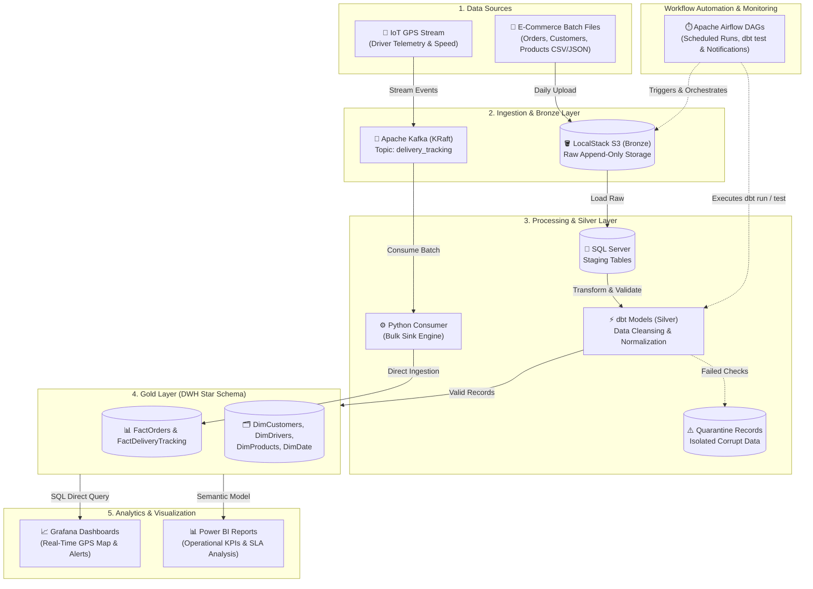

# 🚚 Smart E-Commerce Logistics Data Platform

[](https://github.com)
[](https://www.docker.com/)
[](https://kafka.apache.org/)
[](https://www.getdbt.com/)
[](https://airflow.apache.org/)
[](https://www.microsoft.com/sql-server)
[](https://powerbi.microsoft.com/)
[](https://grafana.com/)
[](https://www.python.org/)

An enterprise-grade, end-to-end data platform designed to process, model, and analyze real-time fleet delivery streams and historical e-commerce logistics data using a **Medallion Architecture (Bronze, Silver, Gold)**, **dbt Transformations**, scheduled Airflow orchestration, automated data quality validation, and dual visualization via **Power BI** and **Grafana**.

---

## 📑 Table of Contents
- [Business Problem & Objectives](#-business-problem--objectives)
- [Key Business Questions Answered](#-key-business-questions-answered)
- [System Architecture](#-system-architecture)
- [Data Storage & Medallion Design](#-data-storage--medallion-design)
- [dbt Transformation & Lineage](#-dbt-transformation--lineage)
- [Data Model & Schema (ERD)](#-data-model--schema-erd)
- [Data Quality & Quarantine Mechanism](#-data-quality--quarantine-mechanism)
- [Serving & Analytics Layer (Power BI & Grafana)](#-serving--analytics-layer-power-bi--grafana)
- [Design Decisions & Trade-Offs](#-design-decisions--trade-offs)
- [Project Structure](#-project-structure)
- [Single-Command Quickstart](#-single-command-quickstart)
- [Monitoring & Alerting](#-monitoring--alerting)

---

## 🎯 Business Problem & Objectives
Logistics and delivery operations struggle with lack of real-time visibility, route delays, high fleet fuel waste, and SLA breaches. 

This platform solves these challenges by:
1. **Streaming Processing:** Ingesting real-time driver GPS locations and shipment telemetry.
2. **Batch & ELT Processing:** Processing transactional sales and delivery records using modular SQL transformations via **dbt**.
3. **Automated Quality:** Isolating corrupted records into quarantine tables without failing the pipelines.
4. **Actionable Insights:** Providing real-time IoT fleet monitoring via **Grafana** and strategic executive KPI dashboards via **Power BI**.

---

## ❓ Key Business Questions Answered
The analytical layer directly answers three core business questions:
1. **What is the real-time SLA breach rate across shipping hubs, and which delivery routes experience the highest delay frequencies?**
2. **How does driver velocity and transit duration correlate with package damage and delayed shipment status?**
3. **What are the peak operational delivery hours and geographical zones to optimize fleet resource allocation?**

---

## 🏗 System Architecture



---

## 🥉🥈🥇 Data Storage & Medallion Design

The platform organizes data across three distinct progressive refinement layers:

| Layer | Technology | Description & Storage Format |
| --- | --- | --- |
| **Bronze (Raw)** | LocalStack S3 / Raw Tables | Immutable, append-only raw batch logs (CSV/JSON) and original streaming payloads partitioned by extraction date (`YYYY/MM/DD`). |
| **Silver (Cleansed)** | dbt (Staging & Intermediate) | Cleaned, deduplicated, standardized schemas with handled nulls and filtered valid types. Stored as views/tables inside SQL Server. |
| **Gold (Curated / DWH)** | dbt Models (Marts) | Production-ready Star Schema optimized for OLAP analytics, aggregated metrics, and incremental watermarking loads. |

---

## ⚡ dbt Transformation & Lineage

Transformation logic is managed entirely within **dbt Core**:

* **Staging Models (`models/staging`):** Type casting, column renaming, and source sanity checks.
* **Marts Models (`models/marts`):** Fact and Dimension table creation with `materialized='incremental'` logic.
* **Auto-Generated Documentation & Lineage:** Generates automated DAG graphs mapping data flow from source tables to analytics marts.

---

## 📊 Data Model & Schema (ERD)

The analytical serving layer uses an optimized **Star Schema**:

### Fact Tables

* **`FactOrders`:** Transactional records covering order status, transit duration, shipping cost, delivery cost, and delivery timestamps.
* **`FactDeliveryTracking`:** Granular streaming GPS telemetries, driver velocities, and coordinates.

### Dimension Tables

* **`DimCustomers`:** Customer profile, address, and localized zone information.
* **`DimDrivers`:** Fleet driver metadata, vehicle specifications, and status.
* **`DimProducts`:** Product catalogue, dimensions, weight, and pricing.
* **`DimDate`:** Complete calendar dimension supporting fiscal and operational time slicing.

---

## 🛡 Data Quality & Quarantine Mechanism

To ensure pipeline resilience, records passing through transformation undergo strict automated validation checks (Uniqueness, Not-Null, Referential Integrity, Valid Coordinate Ranges) using **dbt tests** and custom assertions.

```
Raw Ingestion ---> Validation Filter ---> [Valid Records]   ---> Silver / Gold DWH
                                     ---> [Invalid Records] ---> Quarantine / Reject Table

```

* **Quarantine Pattern:** Erroneous rows (e.g., negative freight costs, invalid GPS lat/lon boundaries, null foreign keys) are diverted to a dedicated `Quarantine_Records` table with error codes and ingestion timestamps.
* **Zero Pipeline Crash:** Pipelines finish their execution cycles gracefully while alerting engineers to examine quarantine batches.

---

## 📈 Serving & Analytics Layer (Power BI & Grafana)

The platform bifurcates analytics into two specialized consumption layers:

1. **Grafana (Real-Time Operations & IoT Telemetry):**
* Live GPS Geomap panel tracking fleet driver locations.
* Real-time gauges for vehicle speed, active deliveries, and transit status.
* Near-zero latency streaming alerts for route bottlenecks.


2. **Power BI (Executive & Strategic Analytics):**
* Multi-page analytical reporting on order fulfillment and SLA compliance.
* Route profitability, fuel efficiency, and carrier performance benchmarks.
* Slicers for temporal (DimDate) and regional (DimCustomers) deep-dives.


---

## ⚖️ Design Decisions & Trade-Offs

| Technology Chosen | Considered Alternative | Justification |
| --- | --- | --- |
| **dbt (dbt-sqlserver)** | Spark / SQL Stored Procedures | Version-controlled, modular SQL modeling, built-in testing, and automatic lineage generation without heavy Spark cluster overhead. |
| **Apache Kafka (KRaft)** | RabbitMQ / AWS Kinesis | High-throughput distributed log structure with KRaft eliminating ZooKeeper dependency, simplifying local dockerized deployment. |
| **LocalStack S3** | MinIO / Native HDFS | Provides local, 100% cloud-compatible AWS S3 API parity, allowing zero-code adjustments if moving to production AWS. |
| **SQL Server 2022** | PostgreSQL / ClickHouse | Robust enterprise relational warehouse capabilities, mature SSMS tooling, and native Windows/Docker hybrid driver support. |
| **Apache Airflow** | Cron / Prefect | Proven dependency DAG graphs, rich ecosystem operators, backfill support, and production-grade retry/failure policies. |
| **Power BI & Grafana** | Metabase / Tableau | Power BI provides deep semantic data modeling and DAX computations, while Grafana excels at sub-second real-time streaming telemetry and IoT dashboards. |

---

## 📁 Project Structure

```bash
smart-logistics-project/
├── .github/
│   └── workflows/ci.yml         # CI/CD pipeline (Linting, pytest)
├── infrastructure/
│   ├── docker-compose.yml       # Complete multi-service orchestration
│   ├── Dockerfile.airflow       # Airflow customized image with drivers
│   └── scripts/                 # Health checks and initialization scripts
├── ingestion/
│   ├── gps_producer.py          # Kafka streaming GPS event generator
│   ├── gps_consumer.py          # Kafka consumer and database sink
│   └── s3_uploader.py           # Batch raw data uploader to LocalStack S3
├── dbt_logistics/               # dbt Transformation Project
│   ├── dbt_project.yml          # dbt configuration
│   ├── models/
│   │   ├── staging/             # Bronze to Silver models
│   │   └── marts/               # Gold Fact & Dimension models
│   └── tests/                   # Custom data quality tests
├── dags/
│   ├── daily_batch_dag.py       # Airflow DAG running dbt and S3 ingestion
│   └── streaming_monitor_dag.py # Airflow DAG for monitoring stream health
├── tests/
│   ├── test_transformations.py  # Unit tests for cleansing functions
│   └── test_quality.py          # Validation assertion tests
├── bi_reports/
│   ├── powerbi_report.pbix      # Power BI semantic model and executive reports
│   └── grafana_dashboards.json  # Exported Grafana live telemetry panels
├── .env.example                 # Environment variables template
├── .gitignore                   # Ignored files (secrets, virtual environments)
├── requirements.txt             # Python dependencies
└── README.md                    # Project documentation

```

---

## 🚀 Single-Command Quickstart

### Prerequisites

* Docker Desktop (v20.10+) with WSL2 enabled.
* Python 3.10+
* Git

### 1. Clone & Prepare Environment

```bash
git clone [https://github.com/abdallahgalalabdallah/smart-E-commerce-logistics-data-platform.git](https://github.com/abdallahgalalabdallah/smart-E-commerce-logistics-data-platform.git)
cd smart-E-commerce-logistics-data-platform
cp .env.example .env

```

### 2. Start Full Infrastructure

Run the entire platform with a single Docker Compose command:

```bash
docker compose -f infrastructure/docker-compose.yml up -d

```

### 3. Verify Services

* **Airflow UI:** `http://localhost:8080` (Default: `airflow` / `airflow`)
* **Kafka Broker:** `localhost:9092`
* **LocalStack (S3):** `http://localhost:4566`
* **SQL Server:** `localhost:1433` (User: `sa`, Database: `smart_logistics_dwh`)
* **Grafana:** `http://localhost:3000` (Default: `admin` / `admin`)

### 4. Run dbt Models & Tests

```bash
cd dbt_logistics
dbt run
dbt test

```

---

## 📈 Monitoring & Alerting

* **Airflow SLA & Retries:** Tasks define a 2-retry policy with exponential backoff on failure.
* **Failure Notifications:** Configured for webhook alerts (Telegram/Slack/Email) whenever critical DAG tasks fail.
* **Runtime Metrics:** Logging tracks execution runtime, processed row volumes, and quarantine error percentages for performance tuning audits.

```

