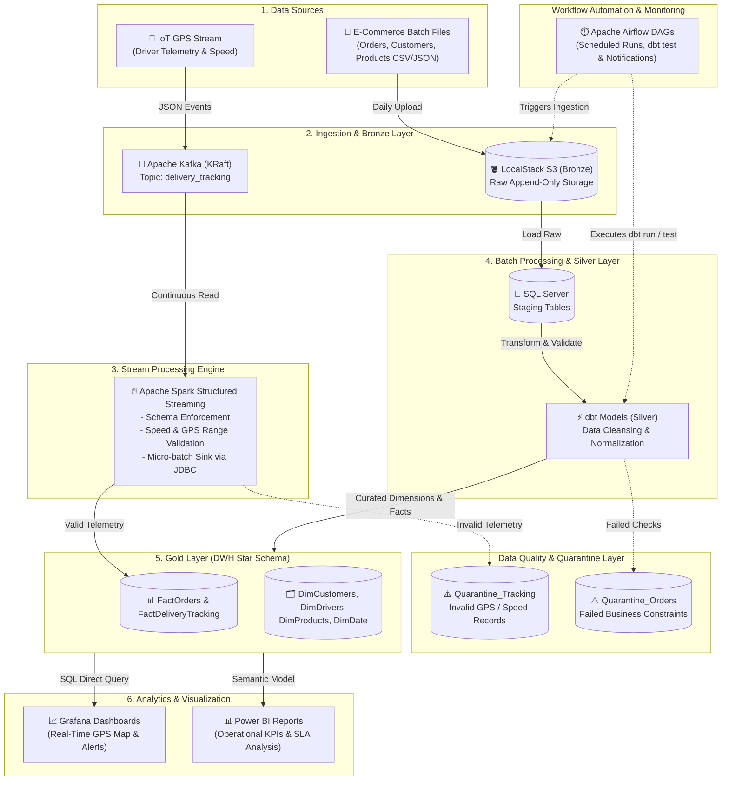

# 🚚 Smart E-Commerce Logistics Data Platform

[](https://github.com)
[](https://www.docker.com/)
[](https://kafka.apache.org/)
[](https://spark.apache.org/)
[](https://www.getdbt.com/)
[](https://airflow.apache.org/)
[](https://www.microsoft.com/sql-server)
[](https://powerbi.microsoft.com/)
[](https://grafana.com/)
[](https://www.python.org/)

An enterprise-grade, end-to-end data platform designed to process, model, and analyze real-time fleet delivery streams and historical e-commerce logistics data using a **Medallion Architecture (Bronze, Silver, Gold)**, **Apache Spark Structured Streaming**, **dbt Transformations**, scheduled Airflow orchestration, automated data quality quarantine routing, and dual visualization via **Power BI** and **Grafana**.

---

## 📑 Table of Contents
- [Business Problem & Objectives](#-business-problem--objectives)
- [Key Business Questions Answered](#-key-business-questions-answered)
- [System Architecture](#-system-architecture)
- [Data Storage & Medallion Design](#-data-storage--medallion-design)
- [Real-Time Stream Processing (Spark Structured Streaming)](#-real-time-stream-processing-spark-structured-streaming)
- [dbt Transformation & Lineage](#-dbt-transformation--lineage)
- [Data Model & Schema (ERD)](#-data-model--schema-erd)
- [Data Quality & Quarantine Mechanism](#-data-quality--quarantine-mechanism)
- [Serving & Analytics Layer (Power BI & Grafana)](#-serving--analytics-layer-power-bi--grafana)
- [Design Decisions & Trade-Offs](#-design-decisions--trade-offs)
- [Project Structure](#-project-structure)
- [Single-Command Quickstart](#-single-command-quickstart)
- [Monitoring & Alerting](#-monitoring--alerting)

---

## 🎯 Business Problem & Objectives
Logistics and delivery operations face severe operational blind spots: lack of sub-second driver visibility, route bottlenecks, package handling damages, and SLA breaches.

This platform addresses these challenges through:
1. **Real-Time Stream Processing:** Continuous stream parsing, windowing, and anomaly routing of vehicle GPS telemetry via **Apache Spark Structured Streaming** from **Apache Kafka**.
2. **Batch & ELT Processing:** Transforming multi-table transactional sales and fulfillment logs using modular SQL models via **dbt Core**.
3. **Automated Quality & Isolation:** Diverting malformed GPS coordinates, corrupt payloads, or schema anomalies directly into Quarantine tables without halting live ingestion.
4. **Actionable Insights:** Providing sub-second fleet monitoring via **Grafana** and executive supply-chain KPIs via **Power BI**.

---

## ❓ Key Business Questions Answered
1. **What is the real-time SLA breach rate across shipping hubs, and which delivery routes experience the highest delay frequencies?**
2. **How does driver velocity and transit duration correlate with package damage and delayed shipment status?**
3. **What are the peak operational delivery hours and geographical zones to optimize fleet resource allocation?**

---

## 🏗 System Architecture



---

## 🥉🥈🥇 Data Storage & Medallion Design

| Layer | Technology | Description & Storage Format |
| --- | --- | --- |
| **Bronze (Raw)** | LocalStack S3 & Raw Tables | Immutable, append-only raw batch logs (CSV/JSON) and original streaming payloads partitioned by ingestion timestamp. |
| **Silver (Cleansed)** | Spark Streaming & dbt (Staging) | Cleaned, deduplicated, and validated records. Out-of-bounds telemetry and schema anomalies are diverted to Quarantine tables. |
| **Gold (Curated / DWH)** | SQL Server 2022 (dbt Marts) | Production Star Schema optimized for OLAP analytics, aggregated delivery metrics, and incremental watermarking loads. |

---

## 🔥 Real-Time Stream Processing (Spark Structured Streaming)

Real-time fleet tracking bypasses generic polling consumers in favor of **Spark Structured Streaming**:

* **Schema Enforcement:** Parses raw Kafka JSON payloads against an explicit schema to prevent pipeline failure.
* **Stream Validation:** Validates coordinate boundaries and positive velocity thresholds on the fly.
* **Dual Routing:** Micro-batches write valid records directly into `FactDeliveryTracking` while diverting corrupt or out-of-boundary records to `Quarantine_Tracking`.
* **Stateful Windowing (Optional):** Computes rolling 5-minute average driver velocities to flag speeding and sudden delays before reaching the warehouse.

---

## ⚡ dbt Transformation & Lineage

Batch data transformation is orchestrated inside **dbt Core**:

* **Staging Models (`models/staging`):** Column renaming, data type casting, and standardizing categorical fields.
* **Marts Models (`models/marts`):** Incremental loads (`materialized='incremental'`) computing facts and slowly changing dimensions.
* **Lineage & Docs:** Generates automated interactive dependency DAG graphs from Bronze staging through Gold marts.

---

## 📊 Data Model & Schema (ERD)

The analytical serving layer uses a high-performance **Star Schema**:

### Fact Tables

* **`FactOrders`:** Transactional records covering order status, transit duration, shipping cost, delivery cost, and delivery timestamps.
* **`FactDeliveryTracking`:** Granular streaming GPS telemetries, driver velocities, and coordinates populated by Spark.

### Dimension Tables

* **`DimCustomers`:** Customer profile, address, and localized zone information.
* **`DimDrivers`:** Fleet driver metadata, vehicle specifications, and status.
* **`DimProducts`:** Product catalogue, dimensions, weight, and pricing.
* **`DimDate`:** Complete calendar dimension supporting fiscal and operational time slicing.

---

## 🛡 Data Quality & Quarantine Mechanism

To ensure high data integrity without pipeline interruptions, validation occurs at both stream and batch ingestion points:

```
[Kafka Stream] ──> Spark Validation Filter ──┬──> [Valid Rows]   ──> FactDeliveryTracking
                                             └──> [Invalid Rows] ──> Quarantine_Tracking

[S3 Batch]    ──> dbt Test Validation     ──┬──> [Valid Rows]   ──> FactOrders / DimTables
                                             └──> [Invalid Rows] ──> Quarantine_Orders

```

* **Quarantine Pattern:** Malformed events (null foreign keys, negative costs, GPS lat/lon out of geographic bounds) are tagged with rejection reasons and written to dedicated quarantine tables.
* **Zero Pipeline Crash:** Pipelines complete scheduled cycles gracefully while generating alerts for manual triage.

---

## 📈 Serving & Analytics Layer (Power BI & Grafana)

1. **Grafana (Real-Time Operations & IoT Telemetry):**
* Live GPS Geomap panel tracking fleet driver locations.
* Real-time gauges for vehicle speed, active deliveries, and transit status.
* Near-zero latency streaming alerts for route bottlenecks.


2. **Power BI (Executive & Strategic Analytics):**
* Multi-page analytical reporting on order fulfillment and SLA compliance.
* Route profitability, fuel efficiency, and carrier performance benchmarks.
* Slicers for temporal (`DimDate`) and regional (`DimCustomers`) deep-dives.


---

## ⚖️ Design Decisions & Trade-Offs

| Technology Chosen | Considered Alternative | Justification |
| --- | --- | --- |
| **Apache Spark Streaming** | Plain Python Consumer | Native micro-batch fault tolerance, distributed window aggregations, and robust schema enforcement at scale. |
| **Apache Kafka (KRaft)** | RabbitMQ / AWS Kinesis | High-throughput distributed log structure with KRaft eliminating ZooKeeper dependency, simplifying local dockerized deployment. |
| **dbt (dbt-sqlserver)** | Stored Procedures / SSIS | Version-controlled, modular SQL modeling, built-in automated testing, and auto-generated data lineage. |
| **LocalStack S3** | MinIO / Native HDFS | Provides 100% cloud-compatible AWS S3 API parity for seamless migration to production AWS environments. |
| **SQL Server 2022** | PostgreSQL / ClickHouse | Robust enterprise relational warehouse capabilities, mature SSMS tooling, and native Windows/Docker hybrid driver support. |
| **Apache Airflow** | Cron / Prefect | Proven dependency DAG graphs, rich ecosystem operators, backfill support, and production-grade retry/failure policies. |
| **Power BI & Grafana** | Metabase / Tableau | Power BI provides deep semantic data modeling and DAX computations, while Grafana excels at sub-second real-time streaming telemetry. |

---

## 📁 Project Structure

```bash
smart-logistics-project/
├── .github/
│   └── workflows/ci.yml         # CI/CD pipeline (Linting, pytest)
├── infrastructure/
│   ├── docker-compose.yml       # Multi-service infrastructure (Kafka, SQL Server, LocalStack, Airflow)
│   ├── Dockerfile.airflow       # Airflow customized image with drivers
│   └── scripts/                 # Health checks and initialization scripts
├── streaming/
│   ├── gps_producer.py          # Kafka streaming GPS event generator
│   └── spark_stream_processor.py# Spark Structured Streaming engine & JDBC sink
├── ingestion/
│   └── s3_uploader.py           # Batch raw data uploader to LocalStack S3
├── dbt_logistics/               # dbt Transformation Project
│   ├── dbt_project.yml          # dbt configuration
│   ├── models/
│   │   ├── staging/             # Bronze to Silver models
│   │   └── marts/               # Gold Fact & Dimension models
│   └── tests/                   # Custom data quality tests
├── dags/
│   ├── daily_batch_dag.py       # Airflow DAG running S3 ingestion and dbt models
│   └── streaming_monitor_dag.py # Airflow DAG for monitoring streaming health
├── tests/
│   ├── test_transformations.py  # Unit tests for cleansing functions
│   └── test_quality.py          # Validation assertion tests
├── bi_reports/
│   ├── powerbi_report.pbix      # Power BI semantic model and executive reports
│   └── grafana_dashboards.json  # Exported Grafana live telemetry panels
├── .env.example                 # Environment variables template
├── .gitignore                   # Ignored files (secrets, virtual environments)
├── requirements.txt             # Python dependencies
└── README.md                    # Project documentation

```

---

## 🚀 Single-Command Quickstart

### Prerequisites

* Docker Desktop (v20.10+) with WSL2 enabled.
* Python 3.10+
* Apache Spark (v3.4+) & Java 11/17 (or run via container)
* Git

### 1. Clone & Prepare Environment

```bash
git clone [https://github.com/abdallahgalalabdallah/smart-E-commerce-logistics-data-platform.git](https://github.com/abdallahgalalabdallah/smart-E-commerce-logistics-data-platform.git)
cd smart-E-commerce-logistics-data-platform
cp .env.example .env

```

### 2. Start Full Infrastructure

Run the entire platform with a single Docker Compose command:

```bash
docker compose -f infrastructure/docker-compose.yml up -d

```

### 3. Verify Services

* **Airflow UI:** `http://localhost:8080` (Default: `airflow` / `airflow`)
* **Kafka Broker:** `localhost:9092`
* **LocalStack (S3):** `http://localhost:4566`
* **SQL Server:** `localhost:1433` (User: `sa`, Database: `smart_logistics_dwh`)
* **Grafana:** `http://localhost:3000` (Default: `admin` / `admin`)

### 4. Run Streaming Pipeline

```bash
# Terminal 1: Start Producer
python streaming/gps_producer.py

# Terminal 2: Start Spark Structured Streaming
spark-submit --packages org.apache.spark:spark-sql-kafka-0-10_2.12:3.5.0,com.microsoft.sqlserver:mssql-jdbc:12.4.2.jre11 streaming/spark_stream_processor.py

```

### 5. Run dbt Transformations & Tests

```bash
cd dbt_logistics
dbt run
dbt test

```

---

## 📈 Monitoring & Alerting

* **Airflow SLA & Retries:** Tasks define a 2-retry policy with exponential backoff on failure.
* **Failure Notifications:** Configured for webhook alerts (Telegram/Slack/Email) whenever critical DAG tasks fail.
* **Runtime Metrics:** Logging tracks execution runtime, processed row volumes, and quarantine error percentages for performance tuning audits.

```
